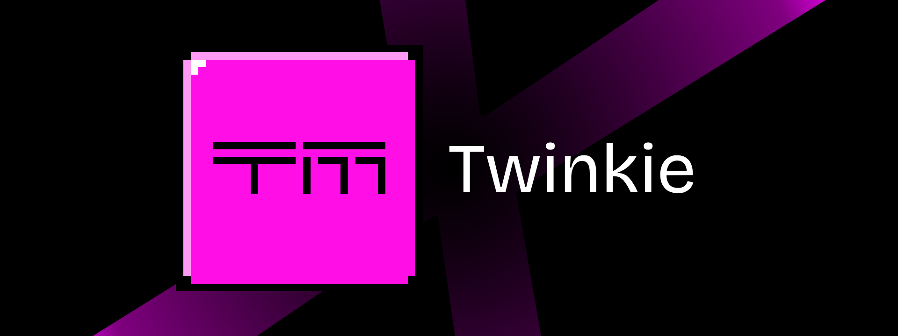
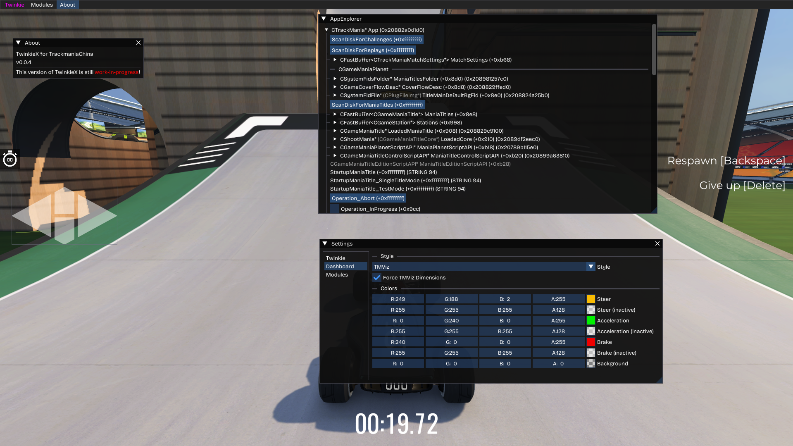
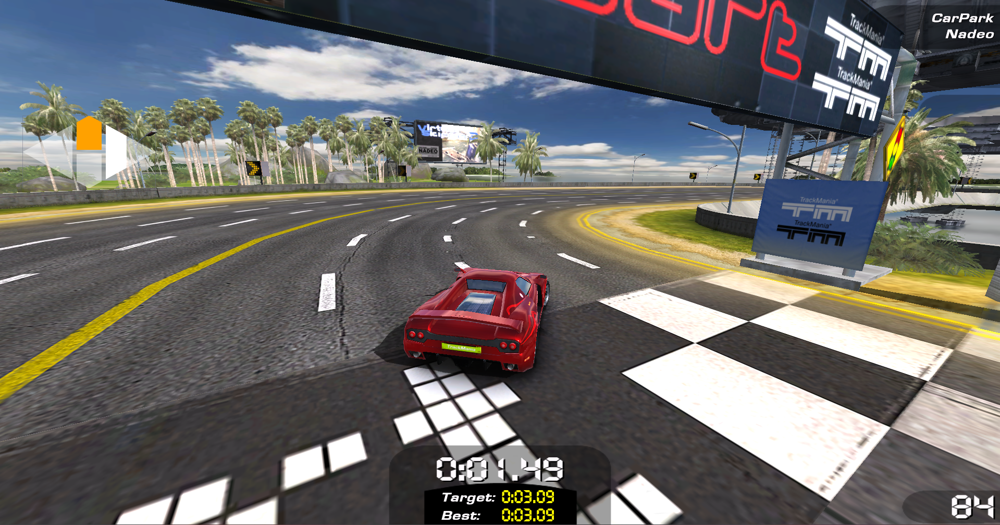
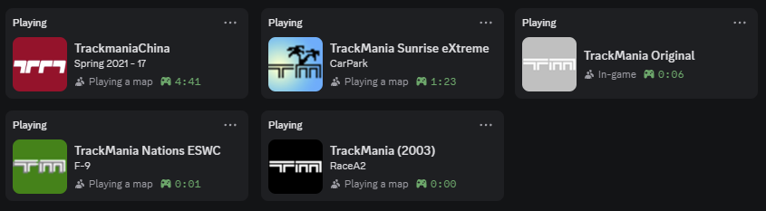

 

    
    
    
    
    

A work-in-progress cross-game fork of Twinkie for TM1.0, TMS, TMSX, TMO, TMNESWC, TMU, and TMCN.

## Features (currently implemented)
- **Automatic** GitHub release and versioning
- **Settings** and preferences management
- **Window resize patch** for older Trackmania games.
- A **nod explorer** for viewing game classes
- Support for **Trackmania coloring syntax in ImGui**
- **Discord Rich Presence** integration
- On-the-fly **module import** for C++ modules (WIP)
- Basic **Angelscript scripting** support for modules (WIP)

## Special thanks
- [GreffMASTER](https://github.com/GreffMASTER), and his [TMStuff](https://github.com/GreffMASTER/TMStuff) project for providing insight into TM1.0 and general GameBox technical details
- [BigBang1112](https://github.com/BigBang1112), and [brokenphilip](https://github.com/brokenphilip) for helping with technical details
- All testers and bug reporters
- You <3

## Contribute
You are welcome to contribute to this project.

## Notes
1. **TMS** is still **not supported**.
2. **Do not launch in fullscreen** if you're not playing TMCN.

## Screenshots

## Support
There aren't any financial ways you can support TwinkieTweaks with, but we will be happy with a star!
